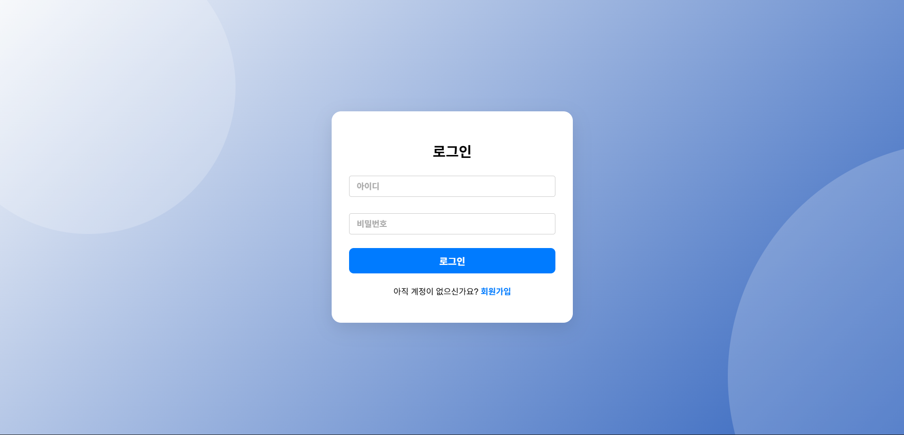
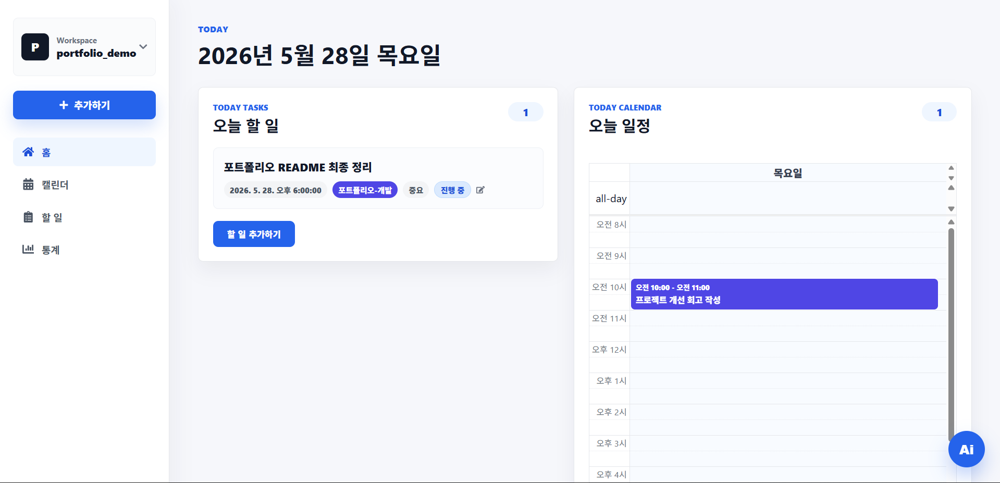
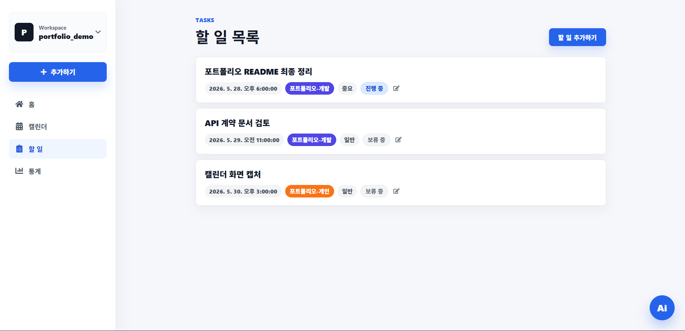
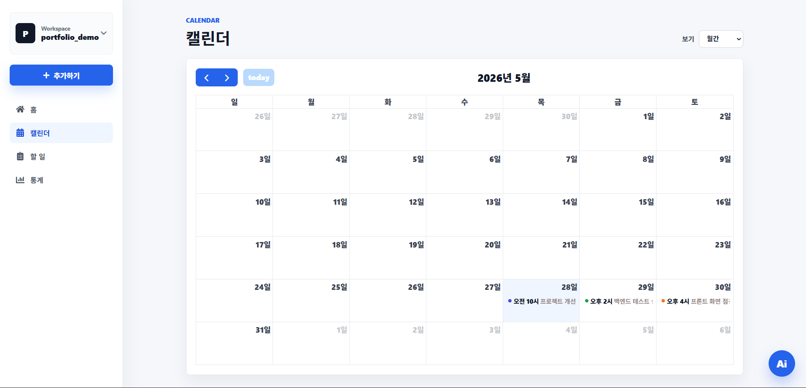
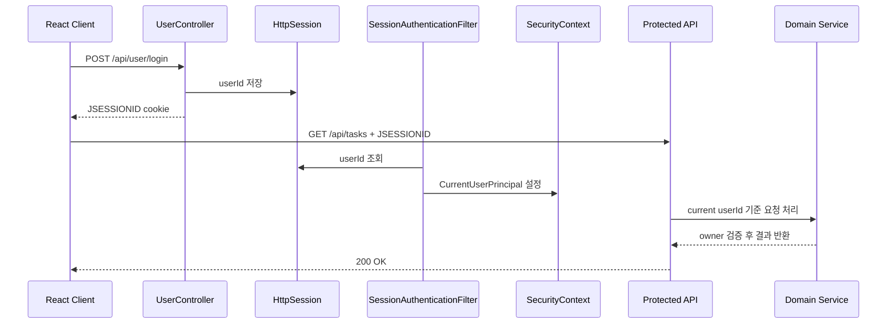
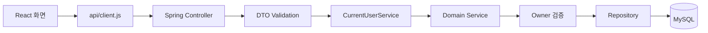
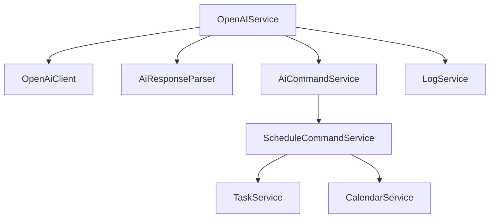

# TimeTodo

학생 시절 제작한 일정/할 일 관리 프로젝트를 다시 실행 가능한 상태로 복구하고, 보안·구조·API·테스트 리스크를 단계적으로 개선한 프로젝트입니다.

단순 기능 소개보다 “기능 중심으로 작성된 기존 코드를 어떻게 유지보수 가능한 구조로 정리했는가”에 초점을 둔 포트폴리오용 저장소입니다.

## 프로젝트 개요

TimeTodo는 일정, 할 일, 카테고리, 통계, AI 입력 기반 일정/할 일 생성 기능을 포함한 웹 애플리케이션입니다.

| 영역 | 기술 |
|---|---|
| Frontend | React 18, Create React App, axios, FullCalendar |
| Backend | Java 17, Spring Boot 3.3.4, Spring MVC, Spring Data JPA, Spring Security |
| DB | MySQL, Flyway |
| AI | OpenAI API 연동 |
| Test | JUnit 5, Mockito, Spring MVC Test |

## 화면

### 로그인



### 홈



### 할 일



### 캘린더



## 개선 요약

| 구분 | 기존 문제 | 개선 결과 |
|---|---|---|
| 폴더 구조 | 프론트엔드와 백엔드가 한 폴더 안에 혼재 | `frontEnd/`, `backEnd/`, `docs/`로 분리 |
| 비밀값 관리 | DB credential, OpenAI API key가 설정 파일에 직접 들어갈 위험 | `.env`와 `.env.example` 기준으로 분리 |
| 로그인 실패 | 인증 실패 시 `NullPointerException`으로 500 발생 가능 | 실패 시 `401 Unauthorized` 반환 |
| 비밀번호 저장 | 평문 비밀번호 저장 및 평문 비교 | BCrypt hash 저장과 `PasswordEncoder.matches()` 적용 |
| 사용자 식별 | 클라이언트 `userId` 쿠키 값을 서버가 신뢰 | 서버 `HttpSession`과 Spring Security 기반으로 현재 사용자 확인 |
| 권한 검증 | 수정/삭제 API에서 resource owner 검증 부족 | Task, Calendar, Category 등 owner 검증 추가 |
| API 설계 | `/add`, `/find`, `/update` 같은 동사 중심 path 혼재 | RESTful path와 API contract 문서 정리 |
| Entity naming | `userId` 필드가 실제로는 `UserEntity` 타입 | `user`, `category`, `reminders`처럼 관계명 기준으로 정리 |
| AI 기능 | OpenAI 호출, parsing, 도메인 생성 책임이 한 service에 집중 | client, parser, command, domain 생성 책임 분리 |
| DB schema | Hibernate `ddl-auto=update` 의존 | Flyway migration과 Hibernate `validate` 기반으로 변경 |
| 테스트 | 리팩터링 안전망 부족 | service, auth, controller, AI parser/command 테스트 추가 |

## 구조 변경

### 개선 전

기존에는 프론트엔드와 백엔드가 `TimeTODOhh/` 안에 섞여 있어 실행 환경과 책임 경계가 불명확했습니다.

```text
Timetodo/
  README.md
  TimeTODOhh/
    src/
    public/
    package.json
    pom.xml
    ...
```

### 개선 후

```text
Timetodo/
  README.md
  frontEnd/
    src/
    package.json
  backEnd/
    src/
    pom.xml
    .env.example
  docs/
    계약/
    계획/
    기록/
    실행/
    이미지/
    진단/
    테스트/
```

## 인증 구조

초기 구조는 클라이언트가 가진 `userId` 쿠키를 서버가 그대로 신뢰하는 방식이었습니다. 이 구조에서는 쿠키 값을 바꾸면 다른 사용자의 데이터에 접근할 위험이 있었습니다.

현재는 로그인 성공 시 서버 세션에 사용자 ID를 저장하고, 보호 API 요청마다 세션 기반 사용자 정보를 Spring Security `SecurityContext`에 연결합니다.



## API 흐름

Controller는 현재 사용자 식별과 request validation을 담당하고, Service는 owner 검증과 도메인 규칙을 담당합니다. Repository는 persistence 경계로 제한했습니다.



주요 API path는 다음처럼 정리했습니다.

| 기능 | Method | Path |
|---|---:|---|
| 현재 사용자 | `GET` | `/api/user/me` |
| 할 일 목록 | `GET` | `/api/tasks` |
| 할 일 생성 | `POST` | `/api/tasks` |
| 할 일 수정 | `PUT` | `/api/tasks/{taskId}` |
| 할 일 상태 변경 | `PATCH` | `/api/tasks/{taskId}/status` |
| 일정 목록 | `GET` | `/api/calendars` |
| 일정 생성 | `POST` | `/api/calendars` |
| 일정 수정 | `PUT` | `/api/calendars/{calendarId}` |
| 카테고리 목록 | `GET` | `/api/categories` |
| 카테고리 생성 | `POST` | `/api/categories` |

상세 계약은 [API_계약.md](docs/계약/API_계약.md)를 기준으로 관리합니다.

## AI 기능 분리

기존 AI 기능은 OpenAI HTTP 호출, 응답 parsing, Task/Calendar 생성, log 저장 책임이 하나의 service에 집중되어 있었습니다. 현재는 변경 영향 범위를 줄이기 위해 아래처럼 분리했습니다.



개선 결과:

- OpenAI 응답 parsing 테스트를 API 호출 없이 작성 가능
- AI command가 Task/Calendar 생성 책임과 분리됨
- AI 생성 Task/Calendar가 특정 category ID `1`에 의존하지 않음
- 사용자별 `AI 기본-{userId}` category를 조회하거나 없으면 생성

## DB Migration

DB schema는 Flyway로 관리합니다.

| 파일 | 목적 |
|---|---|
| `V1__init_schema.sql` | 초기 schema 정의 |
| `V2__rename_relation_columns.sql` | Task/Calendar relation column을 `category_id`, `user_id`로 정리 |

local profile은 Hibernate `ddl-auto=validate`를 사용합니다. schema 변경은 Hibernate 자동 변경에 의존하지 않고 migration 파일로 관리합니다.

## 검증

현재 확인한 검증 명령입니다.

```bash
cd backEnd
bash ./mvnw test
```

```bash
cd frontEnd
npm run build
```

검증 결과:

| 항목 | 결과 |
|---|---|
| Backend test | 성공, 30건 통과 |
| Frontend build | 성공 |
| 기존 `timetodo` DB | Flyway V2 적용 및 Hibernate validate 성공 |
| 빈 임시 DB | Flyway V1+V2 적용 및 Hibernate validate 성공 |

## 로컬 실행

### 1. 환경변수 준비

`backEnd/.env.example`을 기준으로 `backEnd/.env`를 생성합니다.

```properties
DB_HOST=localhost
DB_PORT=3306
DB_NAME=timetodo
SERVER_PORT=8085
SPRING_PROFILES_ACTIVE=local
DB_USERNAME=...
DB_PASSWORD=...
OPENAI_API_KEY=...
CORS_ALLOWED_ORIGINS=http://localhost:3000
COOKIE_SECURE=false
COOKIE_SAME_SITE=Lax
```

실제 DB 계정, 비밀번호, OpenAI API key는 Git에 포함하지 않습니다.

### 2. Backend 실행

```bash
cd backEnd
bash ./mvnw spring-boot:run
```

기본 주소:

```text
http://localhost:8085
```

### 3. Frontend 실행

```bash
cd frontEnd
npm run start
```

기본 주소:

```text
http://localhost:3000
```

## 문서

| 문서 | 설명 |
|---|---|
| [1차_구조_진단.md](docs/진단/1차_구조_진단.md) | 초기 구조와 리스크 진단 |
| [1차_개선_기록.md](docs/기록/1차_개선_기록.md) | 비밀번호, 로그인 실패, CORS 개선 기록 |
| [2차_개선_기록.md](docs/기록/2차_개선_기록.md) | 세션 인증, owner 검증, API client 개선 기록 |
| [3차_개선_기록.md](docs/기록/3차_개선_기록.md) | Entity/API/Spring Security/AI 1차 개선 기록 |
| [4차_개선_기록.md](docs/기록/4차_개선_기록.md) | API, validation, DB migration, UX 개선 기록 |
| [API_계약.md](docs/계약/API_계약.md) | 주요 API endpoint와 request/response 계약 |
| [로컬_실행_가이드.md](docs/실행/로컬_실행_가이드.md) | Ubuntu 기준 로컬 실행 절차 |
| [E2E_시나리오.md](docs/테스트/E2E_시나리오.md) | 수동/E2E 자동화 후보 시나리오 |

## 남은 작업

| 우선순위 | 작업 | 이유 |
|---|---|---|
| P1 | E2E 자동화 도입 | 로그인, 할 일, 일정, 카테고리 핵심 흐름을 브라우저 기준으로 검증 |
| P2 | 배포 환경 실제 검증 | `application-prod.properties`는 추가했지만 실제 운영 배포 검증은 별도 필요 |
| P2 | Controller 테스트 추가 확대 | update/delete 정상 흐름과 검색 API까지 커버 확대 |
| P3 | AI 입력 UX 보강 | AI 기능은 책임 분리는 완료했지만 사용자 경험은 추가 개선 여지가 있음 |

## 회고

이 프로젝트의 핵심 성과는 새 기능을 많이 추가한 것이 아니라, 기존에 동작만 하던 학생 프로젝트를 다시 실행 가능한 상태로 복구하고 리스크가 큰 부분부터 우선순위를 정해 개선한 점입니다.

특히 평문 비밀번호, 클라이언트 `userId` 신뢰, owner 검증 부재, 프론트/백엔드 구조 혼재, API 계약 부재는 실제 서비스 코드에서 치명적인 유지보수 리스크였습니다. 이를 인증 경계, API 계약, DB migration, 테스트, 문서화 순서로 정리하면서 포트폴리오에서 설명 가능한 개선 사례로 만들었습니다.
